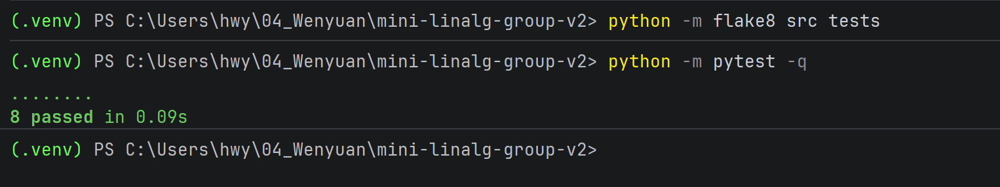
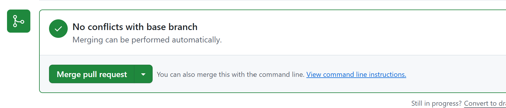

# Wenyuan Huang

- Changes made:  core.py & test_core.py(to pass test)

- Tests run and results:

  

- Conflict resolved, if applicable: 

  

- Branch and pull request: feature/numpy-vectorization — https://github.com/norouzi-UPC/mini-linalg-group-v2/pull/2

- Peer review given (PR link): https://github.com/norouzi-UPC/mini-linalg-group-v2/pull/5 — checked the updated tests and left a comment.
